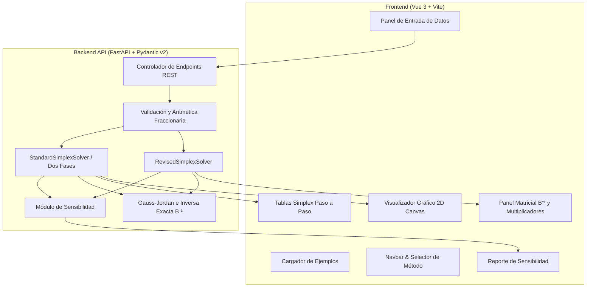

# CIMS — Calculadora Investigativa del Método Simplex

[](https://www.python.org/)
[](https://fastapi.tiangolo.com/)
[](https://vuejs.org/)
[](https://vitejs.dev/)
[-0A9EDC?style=for-the-badge&logo=pytest&logoColor=white)](https://docs.pytest.org/)
[](LICENSE)

**CIMS** (*Calculadora Investigativa del Método Simplex*) es una plataforma interactiva, didáctica y de alto rendimiento diseñada para la resolución, análisis matemático y experimentación con problemas de **Programación Lineal (PL)** e **Investigación de Operaciones**.

El sistema integra motores de resolución exacta basados en **aritmética de fracciones racionales** (sin errores de redondeo por punto flotante), visualización geométrica interactiva en 2D, análisis de sensibilidad post-óptimo y un comparador algorítmico en tiempo real entre el **Método Simplex Tabular** y el **Método Simplex Revisado**.

---

## Tabla de Contenidos

- [Propósito del Proyecto](#propósito-del-proyecto)
- [Características Principales](#características-principales)
- [Métodos y Fundamentos Matemáticos](#métodos-y-fundamentos-matemáticos)
  - [1. Método Simplex Tabular (Estándar)](#1-método-simplex-tabular-estándar)
  - [2. Método de Dos Fases](#2-método-de-dos-fases)
  - [3. Método Simplex Revisado (Formulación Matricial)](#3-método-simplex-revisado-formulación-matricial)
  - [4. Análisis de Sensibilidad y Post-Optimización](#4-análisis-de-sensibilidad-y-post-optimización)
  - [5. Regla de Bland (Anti-Ciclado)](#5-regla-de-bland-anti-ciclado)
  - [6. Visualización Gráfica 2D](#6-visualización-gráfica-2d)
- [Comparativa: Simplex Tabular vs. Simplex Revisado](#comparativa-simplex-tabular-vs-simplex-revisado)
- [Arquitectura del Sistema](#arquitectura-del-sistema)
- [Estructura del Repositorio](#estructura-del-repositorio)
- [Instalación y Guía de Uso](#instalación-y-guía-de-uso)
  - [Prerrequisitos](#prerrequisitos)
  - [1. Configuración del Backend (FastAPI)](#1-configuración-del-backend-fastapi)
  - [2. Configuración del Frontend (Vue 3 + Vite)](#2-configuración-del-frontend-vue-3--vite)
  - [3. Ejecución de Pruebas Unitarias](#3-ejecución-de-pruebas-unitarias)
- [Documentación de la API REST](#documentación-de-la-api-rest)
- [Configuración de Git e Integridad](#configuración-de-git-e-integridad)
- [Licencia](#licencia)

---

## Propósito del Proyecto

En el ámbito de la **Investigación de Operaciones**, los algoritmos de optimización lineal a menudo se presentan como procedimientos mecánicos o como "cajas negras" en software comercial. 

**CIMS** nace como un laboratorio de exploración algorítmica enfocado en:
1. **Didáctica Profunda:** Desglosar cada paso algebraico y matricial (tablas simplex, pruebas de razón mínima, pivotes, matrices $B^{-1}$ y multiplicadores duales $\pi$).
2. **Precisión Numérica Absoluta:** Eliminar inconsistencias causadas por redondeo en coma flotante mediante el uso del módulo de fracciones racionales exactas.
3. **Análisis Crítico:** Permitir al estudiante e investigador contrastar la eficiencia y el comportamiento interno del enfoque tabular frente al enfoque matricial revisado.
4. **Intuición Geométrica:** Conectar directamente el álgebra matricial con la trayectoria de vértices en el poliedro de la región factible en 2 dimensiones.

---

## Características Principales

- **Aritmética Fraccionaria Exacta:** Cálculos internos 100% racionales (`1/3`, `-7/12`, etc.), con salida simultánea en fracción simplificada, decimal y código $\LaTeX$.
- **Maximización y Minimización:** Soporte completo para ambas orientaciones de optimización.
- **Restricciones Mixtas:** Admite desigualdades e igualdades ($\le$, $\ge$, $=$), convirtiendo y normalizando automáticamente el modelo.
- **Detección Automática de Casos Especiales:**
  - Solución Única Óptima.
  - Múltiples Soluciones Óptimas (Óptimos Alternativos).
  - Problema No Acotado (Unbounded).
  - Problema Infactible (Infeasible / Región vacía).
  - Degeneración y ciclados evitados con la **Regla de Bland**.
- **Análisis de Sensibilidad Post-Óptimo Completo:**
  - Precios Sombra (*Shadow Prices*).
  - Costos Reducidos (*Reduced Costs*).
  - Estado Activo / Inactivo (*Binding / Non-Binding*) y holguras/excedentes.
  - Intervalos permisibles de variación (Aumento y disminución permisible para coeficientes $c_j$ y lados derechos $b_i$).
- **Módulo Gráfico 2D:** Trazado en tiempo real del polígono de soluciones factibles, rectas frontera, vector gradiente y recorrido vértice a vértice de la solución Simplex.
- **Modo Comparativo en Paralelo:** Ejecuta el método tabular y el método revisado en simultáneo para validar equivalencia de resultados y comparar tiempos de cómputo en milisegundos.
- **Suite de Pruebas Automatizadas:** Cobertura de validaciones de entrada, casos extremos y consistencia cruzada con **Pytest**.

---

## Métodos y Fundamentos Matemáticos

### 1. Método Simplex Tabular (Estándar)

El **Método Simplex Tradicional** transforma un problema de programación lineal a su forma canónica aumentando la matriz con **variables de holgura** ($s_i \ge 0$) para restricciones de tipo $\le$.

$$\max Z = \mathbf{c}^T \mathbf{x} \quad \text{sujeto a} \quad \mathbf{A}\mathbf{x} \le \mathbf{b}, \; \mathbf{x} \ge 0$$

- **Criterio de Entrada (Variable Entrante):**
  - Maximización: Selecciona la variable no básica con el coeficiente más negativo en el renglón $Z$ (o según la Regla de Bland).
- **Criterio de Salida (Prueba de la Razón Mínima):**
  $$\theta = \min_{i} \left\{ \frac{\bar{b}_i}{\bar{a}_{ik}} \;\middle|\; \bar{a}_{ik} > 0 \right\}$$
- **Pivoteo:** Se aplica eliminación de **Gauss-Jordan** en toda la tabla extendida para actualizar la base.

---

### 2. Método de Dos Fases

Cuando el modelo contiene restricciones con operadores $\ge$ o $=$, no existe una base canónica inicial trivial invertible. El sistema aplica automáticamente el **Método de Dos Fases**:

- **Variables Incorporadas:**
  - Restricciones $\ge$: Se resta una **variable de exceso** ($e_i$) y se suma una **variable artificial** ($a_i$).
  - Restricciones $=$: Se suma una **variable artificial** ($a_i$).
- **Fase 1:**
  - Se define una función objetivo auxiliar: $\min W = \sum a_i$.
  - Si el valor óptimo $W^* = 0$ y todas las variables artificiales salen de la base, el problema es **factible** y se procede a la Fase 2.
  - Si $W^* > 0$, el problema es **infactible** (no existe solución factible).
- **Fase 2:**
  - Se eliminan las columnas artificiales y se restaura la función objetivo original $Z$ con la base factible obtenida para alcanzar la solución óptima final.

---

### 3. Método Simplex Revisado (Formulación Matricial)

En problemas de gran escala, actualizar toda la tabla en cada iteración es computacionalmente ineficiente. El **Método Simplex Revisado** mantiene y actualiza únicamente la **inversa de la matriz base** ($\mathbf{B}^{-1}$) y genera la información necesaria bajo demanda.

```
       ┌───────────────────────────────┐
       │   Base Actual B e Inversa B⁻¹ │
       └──────────────┬────────────────┘
                      │
       1. Multiplicadores duales:  π = c_B · B⁻¹
                      │
       2. Costos reducidos:       z_j - c_j = π · A_j - c_j
                      │
       3. Columna pivote:         d = B⁻¹ · A_entrante
                      │
       4. Razón mínima & Actualización de B⁻¹
```

- **Paso 1: Multiplicadores Simplex (Vector Dual):**
  $$\boldsymbol{\pi}^T = \mathbf{c}_B^T \mathbf{B}^{-1}$$
- **Paso 2: Precios de Evaluación / Costos Reducidos Bajo Demanda:**
  $$\bar{c}_j = \boldsymbol{\pi}^T \mathbf{A}_j - c_j$$
- **Paso 3: Columna Transformada (Dirección de Búsqueda):**
  $$\mathbf{d} = \mathbf{B}^{-1} \mathbf{A}_k$$
- **Paso 4: Solución Básica Actual:**
  $$\mathbf{x}_B = \mathbf{B}^{-1} \mathbf{b}$$

---

### 4. Análisis de Sensibilidad y Post-Optimización

Una vez obtenida la tabla o base óptima $\mathbf{B}$, CIMS evalúa el impacto de variaciones en los parámetros del modelo sin tener que resolverlo desde cero:

1. **Precios Sombra ($\boldsymbol{\pi} = \mathbf{c}_B \mathbf{B}^{-1}$):** Indican la tasa de cambio del valor óptimo $Z^*$ por cada unidad adicional en el recurso $b_i$.
2. **Variables Básicas y No Básicas:** Clasificación del rol de cada variable en el óptimo.
3. **Restricciones Activas (*Binding*) vs. Inactivas (*Non-Binding*):** Identificación de recursos agotados ($s_i = 0$) y recursos sobrantes ($s_i > 0$).
4. **Rangos de Variación Permisible:**
   - **Para lados derechos ($b_i$):** Intervalo $[\underline{b}_i, \bar{b}_i]$ dentro del cual la base óptima actual sigue siendo factible ($\mathbf{B}^{-1}\mathbf{b} \ge 0$).
   - **Para coeficientes de la función objetivo ($c_j$):** Intervalo $[\underline{c}_j, \bar{c}_j]$ dentro del cual la solución óptima actual no cambia ($\bar{c}_k \ge 0$).

---

### 5. Regla de Bland (Anti-Ciclado)

En problemas **degenerados** (donde alguna variable básica toma valor $0$), el método simplex clásico puede entrar en un bucle infinito entre bases idénticas.

CIMS implementa la **Regla de Bland de menor subíndice**:
- En caso de empate en la variable más negativa para entrar a la base, se elige la de menor índice $j$.
- En caso de empate en la razón mínima de salida, se elige la variable básica de menor índice $i$.
- **Garantía teórica:** Evita ciclos infinitos y asegura la convergencia matemática.

---

### 6. Visualización Gráfica 2D

Para problemas con dos variables de decisión ($x_1, x_2$):
- **Cálculo de Semiespacios:** Intersección geométrica de las rectas frontera $a_{i1} x_1 + a_{i2} x_2 = b_i$ con los ejes coordenados no negativos ($x_1 \ge 0, x_2 \ge 0$).
- **Polígono Convexo Factible:** Relleno semitransparente del área de soluciones factibles.
- **Curva de Nivel de la Función Objetivo:** Representación de la recta $c_1 x_1 + c_2 x_2 = Z^*$ perpendicular al vector gradiente.
- **Trayectoria Simplex:** Línea dinámica que ilustra el salto de vértice a vértice durante cada iteración del algoritmo.

---

## Comparativa: Simplex Tabular vs. Simplex Revisado

| Criterio | Método Simplex Tabular | Método Simplex Revisado |
| :--- | :--- | :--- |
| **Estructura de Datos** | Tabla completa $(m+1) \times (n+1)$ | Matriz inversa $\mathbf{B}^{-1}$ de $m \times m$ |
| **Operaciones por Paso** | Actualiza todas las columnas de la matriz | Calcula únicamente la columna de la variable que entra |
| **Eficiencia en $n \gg m$** | Menor (muchas operaciones redundantes) | **Óptima** (ignora variables que no entran) |
| **Facilidad Didáctica** | Muy intuitivo para cálculo manual | Ideal para formulación algebraica y computacional |
| **Cálculo de Sensibilidad** | Requiere leer la tabla final | Se deriva directamente de $\mathbf{B}^{-1}$ |

---

## Arquitectura del Sistema



---

## Estructura del Repositorio

```text
CIMS-Calculadora-Investigativa-Metodo-Simplex-/
├── .gitignore                     # Configuración de exclusión de Git (Python/Node/OS)
├── README.md                      # Documentación completa del proyecto
│
├── backend/                       # Motor Matemático y API REST
│   ├── core/                      # Algoritmos de optimización
│   │   ├── fractions_helper.py    # Álgebra lineal exacta con fracciones
│   │   ├── standard_simplex.py    # Simplex Tabular y Método de Dos Fases
│   │   ├── revised_simplex.py     # Simplex Revisado matricial
│   │   └── sensitivity.py         # Análisis de sensibilidad y precios sombra
│   ├── models/                    # Esquemas de datos y validación Pydantic
│   │   └── schemas.py             # Modelos de entrada/salida y serialización LaTeX
│   ├── tests/                     # Suite de pruebas unitarias
│   │   ├── test_api_endpoints.py  # Pruebas de integración de endpoints REST
│   │   └── test_solvers.py        # Pruebas matemáticas y de casos extremos
│   ├── main.py                    # Aplicación FastAPI y configuración CORS
│   ├── requirements.txt           # Dependencias de Python
│   └── run_tests.py               # Script de ejecución de pruebas
│
└── frontend/                      # Interfaz Gráfica de Usuario (SPA)
    ├── public/                    # Recursos estáticos e iconos
    ├── src/
    │   ├── assets/                # Estilos y recursos gráficos
    │   ├── components/            # Componentes Vue 3
    │   │   ├── CalculatorPanel.vue# Matriz interactiva de entrada de datos
    │   │   ├── ProcessPanel.vue   # Tablas paso a paso, fórmulas e inversa B⁻¹
    │   │   ├── Plot2D.vue         # Canvas de región factible 2D y trayectoria
    │   │   └── Navbar.vue         # Barra superior, presets y temas
    │   ├── App.vue                # Componente principal
    │   ├── main.js                # Punto de entrada de Vue
    │   └── style.css              # Sistema de diseño CSS personalizado
    ├── package.json               # Dependencias de Node.js
    └── vite.config.js             # Configuración del servidor de desarrollo Vite
```

---

## Instalación y Guía de Uso

### Prerrequisitos

- **Python:** Versión `3.10` o superior instalada.
- **Node.js:** Versión `18.x` o superior y `npm`.
- **Git:** Para clonar y versionar el repositorio.

---

### 1. Configuración del Backend (FastAPI)

1. Abra una terminal en la raíz del proyecto y acceda al directorio del backend:
   ```bash
   cd backend
   ```

2. *(Recomendado)* Cree y active un entorno virtual:
   - **En Windows:**
     ```bash
     python -m venv venv
     .\venv\Scripts\activate
     ```
   - **En Linux / macOS:**
     ```bash
     python3 -m venv venv
     source venv/bin/activate
     ```

3. Instale las dependencias necesarias:
   ```bash
   pip install -r requirements.txt
   ```

4. Inicie el servidor de desarrollo:
   ```bash
   uvicorn backend.main:app --reload --port 8000
   ```
   - **API Backend disponible en:** `http://127.0.0.1:8000`  
   - **Documentación interactiva Swagger UI:** `http://127.0.0.1:8000/docs`

---

### 2. Configuración del Frontend (Vue 3 + Vite)

1. En una nueva terminal, acceda al directorio de frontend:
   ```bash
   cd frontend
   ```

2. Instale las dependencias de Node.js:
   ```bash
   npm install
   ```

3. Inicie el servidor de desarrollo de Vite:
   ```bash
   npm run dev
   ```

4. Abra su navegador web en la dirección indicada (por defecto `http://localhost:5173`).

---

### 3. Ejecución de Pruebas Unitarias

Para verificar la integridad matemática y el correcto funcionamiento de los endpoints:

```bash
python backend/run_tests.py
```
O directamente con `pytest`:
```bash
pytest backend/tests -v
```

---

## Documentación de la API REST

| Método | Endpoint | Descripción |
| :--- | :--- | :--- |
| `GET` | `/health` | Estado del servicio y disponibilidad del motor. |
| `GET` | `/api/examples` | Retorna catálogo de problemas predefinidos (producción, no acotados, etc.). |
| `POST` | `/api/solve/standard` | Resuelve mediante Simplex Tabular Tradicional (incluye Dos Fases si aplica). |
| `POST` | `/api/solve/revised` | Resuelve mediante Simplex Revisado matricial ($\mathbf{B}^{-1}$). |
| `POST` | `/api/solve/compare` | Ejecuta ambos solvers simultáneamente y genera un reporte comparativo de consistencia. |

### Ejemplo de Petición JSON (`POST /api/solve/standard`):

```json
{
  "objective_type": "MAXIMIZE",
  "c": [3, 5],
  "A": [
    [1, 0],
    [0, 2],
    [3, 2]
  ],
  "constraint_types": ["<=", "<=", "<="],
  "b": [4, 12, 18],
  "variable_names": ["x1", "x2"],
  "use_blands_rule": true
}
```

---

## Configuración de Git e Integridad

El repositorio cuenta con un archivo `.gitignore` exhaustivo en la raíz que previene la subida accidental de archivos innecesarios o sensibles a GitHub:

- **Entornos y dependencias:** `node_modules/`, `venv/`, `.venv/`.
- **Cachés de compilación:** `__pycache__/`, `*.pyc`, `.pytest_cache/`, `dist/`.
- **Archivos de configuración local/IDE:** `.vscode/*`, `.idea/`, `.DS_Store`, `Thumbs.db`.
- **Variables de entorno:** `.env`, `.env.local`.

---

## Licencia

Este proyecto se distribuye bajo los términos de la Licencia **MIT**. Consulte el archivo `LICENSE` para más detalles.

---

<div align="center">
  <sub>Desarrollado con fines educativos y de investigación en Optimización Matemática e Investigación de Operaciones.</sub>
</div>
