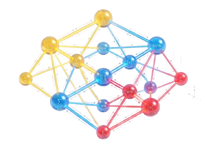
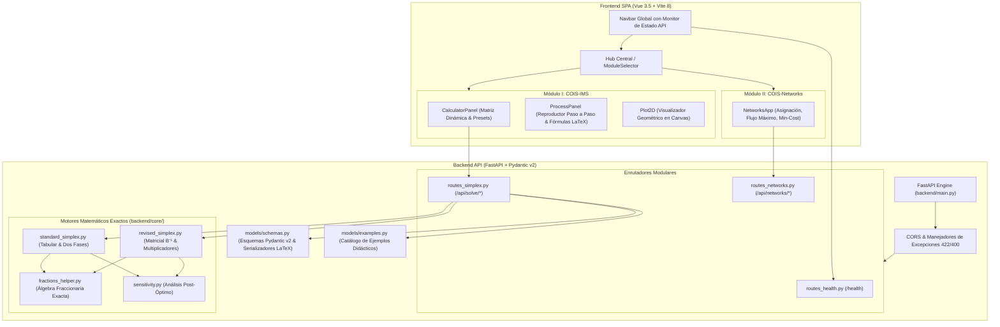

# COIS — Calculadora de Operaciones Investigativas Suite (v2.0)

<div align="center">
  
  <h3>Plataforma Académica e Investigativa de Optimización Matemática e Investigación de Operaciones</h3>
  <p><em>Resolución analítica exacta paso a paso, aritmética de fracciones racionales puras, álgebra matricial y visualización interactiva.</em></p>

  [](https://www.python.org/)
  [-009688?style=for-the-badge&logo=fastapi&logoColor=white)](https://fastapi.tiangolo.com/)
  [](https://vuejs.org/)
  [](https://vitejs.dev/)
  [-0284C7?style=for-the-badge)](#-visión-general)
  [-0A9EDC?style=for-the-badge&logo=pytest&logoColor=white)](https://docs.pytest.org/)
  [](#-aviso-académico-propiedad-intelectual-y-derechos-de-autor)
  [](#-aviso-académico-propiedad-intelectual-y-derechos-de-autor)
</div>

---

## 📌 Visión General

**COIS** (*Calculadora de Operaciones Investigativas Suite*) es una plataforma de software educativa, de investigación y desarrollo algorítmico concebida para desmitificar los modelos de **Investigación de Operaciones (IO)** y **Optimización Matemática**. 

A diferencia de los solvers industriales de "caja negra" que ocultan el procedimiento interno y arrastran imprecisiones numéricas por redondeo en coma flotante (`IEEE 754`), **COIS** prioriza la **didáctica profunda**, la **trazabilidad algebraica total** y la **aritmética racional exacta**.

La suite cuenta con una arquitectura de interfaz dividida en módulos temáticos independientes conectados a un backend de alto rendimiento desarrollado en **FastAPI**:

<div align="center">
  <table>
    <tr>
      <td align="center" width="50%">
        <br/>
        <strong>MÓDULO I: COIS-IMS</strong><br/>
        <em>Investigación del Método Simplex</em><br/>
        Programación Lineal Continua, Simplex Tabular, Dos Fases, Simplex Revisado ($B^{-1}$), Sensibilidad Post-Óptima y Gráfico 2D.
      </td>
      <td align="center" width="50%">
        <br/>
        <strong>MÓDULO II: COIS-Networks</strong><br/>
        <em>Optimización en Redes y Grafos</em><br/>
        Modelos de Transporte y Asignación (Kuhn-Munkres / Húngaro), Flujo Máximo (Edmonds-Karp / Ford-Fulkerson) y Flujo a Costo Mínimo.
      </td>
    </tr>
  </table>
</div>

---

## 📑 Tabla de Contenidos

- [Visión General](#-visión-general)
- [Versiones del Proyecto](#-versiones-del-proyecto)
  - [Versión 1.0 — CIMS (Calculadora Monoproducto Simplex)](#versión-10--cims-calculadora-investigativa-del-método-simplex)
  - [Versión 2.0 — COIS Suite (Ecosistema Multimódulo Actual)](#versión-20--cois-suite-calculadora-de-operaciones-investigativas-suite---actual)
- [Módulos de la Suite](#-módulos-de-la-suite)
  - [Módulo I: COIS-IMS (Programación Lineal & Simplex)](#módulo-i-cois-ims-programación-lineal--simplex)
  - [Módulo II: COIS-Networks (Optimización en Redes & Algoritmos de Grafos)](#módulo-ii-cois-networks-optimización-en-redes--algoritmos-de-grafos)
- [Fundamentos Matemáticos y Algorítmicos](#-fundamentos-matemáticos-y-algorítmicos)
  - [1. Aritmética de Fracciones Racionales Exactas](#1-aritmética-de-fracciones-racionales-exactas)
  - [2. Método Simplex Tabular y Método de Dos Fases](#2-método-simplex-tabular-y-método-de-dos-fases)
  - [3. Método Simplex Revisado (Formulación Matricial con $B^{-1}$)](#3-método-simplex-revisado-formulación-matricial-con-b-1)
  - [4. Análisis de Sensibilidad y Post-Optimización](#4-análisis-de-sensibilidad-y-post-optimización)
  - [5. Regla de Bland (Anti-Ciclado)](#5-regla-de-bland-anti-ciclado)
  - [6. Visualización Gráfica Geométrica 2D](#6-visualización-gráfica-geométrica-2d)
  - [7. Algoritmos de Redes (Asignación, Flujo Máximo, Costo Mínimo)](#7-algoritmos-de-redes-asignación-flujo-máximo-costo-mínimo)
- [Comparativa: Simplex Tabular vs. Simplex Revisado](#-comparativa-simplex-tabular-vs-simplex-revisado)
- [Arquitectura del Sistema](#-arquitectura-del-sistema)
- [Estructura del Proyecto](#-estructura-del-proyecto)
- [Instalación y Despliegue Local](#-instalación-y-despliegue-local)
  - [Prerrequisitos](#prerrequisitos)
  - [1. Configuración del Backend (FastAPI)](#1-configuración-del-backend-fastapi)
  - [2. Configuración del Frontend (Vue 3 + Vite)](#2-configuración-del-frontend-vue-3--vite)
  - [3. Ejecución de Pruebas Automatizadas (Pytest)](#3-ejecución-de-pruebas-automatizadas-pytest)
- [Documentación de la API REST](#-documentación-de-la-api-rest)
- [Configuración de Git e Integridad](#-configuración-de-git-e-integridad)
- [Aviso Académico, Propiedad Intelectual y Derechos de Autor](#-aviso-académico-propiedad-intelectual-y-derechos-de-autor)

---

## 🔄 Versiones del Proyecto

### Versión 1.0 — CIMS (*Calculadora Investigativa del Método Simplex*)
Fue la versión inicial del repositorio antes de la renovación integral, orientada como una herramienta de único propósito:
- **Alcance Monoproducto:** Limitado exclusivamente a la formulación y resolución de problemas de Programación Lineal Continua.
- **Enfoque Algorítmico:** Método Simplex Tabular tradicional y primeras pruebas del Simplex Revisado.
- **Estructura Backend:** Archivo monolítico acoplado con esquemas básicos de validación.
- **Interfaz Directa:** Acceso sin menú selector; abría directamente la calculadora Simplex.
- **Visualización Inicial:** Tablas simplex básicas sin el entorno multimódulo ni soporte para teoría de grafos y redes.

---

### Versión 2.0 — COIS Suite (*Calculadora de Operaciones Investigativas Suite - Actual*)
La versión renovada actual consolida un salto generacional hacia una plataforma integral de **Investigación de Operaciones**:
- **Evolución a Suite Multimódulo:** Se introduce el **Hub Central** (`ModuleSelector.vue`) con arquitectura desacoplada para navegar fluidamente entre distintas disciplinas de optimización matemática.
- **Módulo I Renovado (COIS-IMS):**
  - Motor de fracciones racionales exactas de 2.ª generación (eliminación completa de imprecisiones por punto flotante).
  - Simplex Tabular y Método de Dos Fases con visualización paso a paso, pivotes destacados y fórmulas $\LaTeX$.
  - Simplex Revisado matricial con descomposición explícita de $\mathbf{B}^{-1}$ y multiplicadores duales $\boldsymbol{\pi}$.
  - Análisis de sensibilidad post-óptimo con cálculo de precios sombra y rangos admisibles $[\underline{b}_i, \bar{b}_i]$ y $[\underline{c}_j, \bar{c}_j]$.
  - Trazado geométrico interactivo en tiempo real de la región factible y trayectoria en Canvas 2D.
  - Regla de Bland para garantía teórica contra ciclados en bases degeneradas.
- **Nuevo Módulo II (COIS-Networks):**
  - Motor completo para algoritmos combinatorios y de grafos.
  - Problema de Asignación con el Algoritmo de Kuhn-Munkres / Húngaro ($O(n^3)$), con soporte para matrices rectangulares desbalanceadas, maximización y asignaciones prohibidas (costo $M$).
  - Problema de Flujo Máximo mediante Edmonds-Karp / Ford-Fulkerson ($O(V \cdot E^2)$) y visualización del Teorema de Corte Mínimo (*Max-Flow Min-Cut*).
  - Problema de Flujo a Costo Mínimo (*Min-Cost Flow*) mediante caminos mínimos sucesivos y potenciales duales.
- **Backend FastAPI 2.0:** Arquitectura modular orientada a principios SOLID con routers desacoplados (`routes_health.py`, `routes_simplex.py`, `routes_networks.py`), validaciones Pydantic v2 fail-fast y suite de 23 pruebas automatizadas al 100%.
- **Frontend SPA de Última Generación:** Vue 3.5, Vite 8, Dark Mode Glassmorphism, alternador reactivo fracción/decimal, dock con telemetría de API en tiempo real y animaciones celebratorias con confeti.

#### Cuadro Comparativo: v1.0 vs. v2.0

| Dimensión | Versión 1.0 (CIMS) | Versión 2.0 (COIS Suite) |
| :--- | :--- | :--- |
| **Concepto de Software** | Calculadora simplex mono-herramienta | **Suite Multimódulo Integral de IO** |
| **Módulos Disponibles** | 1 (Simplex elemental) | **2 (COIS-IMS + COIS-Networks)** |
| **Optimización en Redes** | No disponible | **Asignación (Húngaro), Flujo Máximo y Min-Cost** |
| **Navegación / Hub** | Vista única sin transiciones | **Lanzador Central interactivo (`ModuleSelector`)** |
| **Backend REST** | Archivo monolítico | **Enrutadores modulares y desacoplados** |
| **Validación de Datos** | Validaciones elementales | **Pydantic v2 fail-fast con respuestas 422 y 400** |
| **Suite de Pruebas** | Pruebas básicas | **23 pruebas unitarias e integración (100% efectivas)** |
| **Diseño y UX** | Interfaz básica | **Dark Mode Glassmorphism, Canvas 2D y monitor API** |

## 🚀 Módulos de la Suite

### Módulo I: COIS-IMS (Programación Lineal & Simplex)

Especializado en la formulación, exploración y resolución analítica de problemas continuos de programación lineal:

- **Resolución Exacta con Fracciones:** Cálculos sin pérdida de precisión (`1/3`, `-7/12`, etc.), con alternancia en tiempo real a decimales (`0.333...`) y formato $\LaTeX$.
- **Objetivos Flexibles:** Maximización y Minimización con cualquier combinación de restricciones lineales ($\le$, $\ge$, $=$).
- **Tratamiento Automático de Restricciones Mixtas:** Inclusión de variables de holgura ($s_i$), exceso ($e_i$) y artificiales ($a_i$) con orquestación del **Método de Dos Fases**.
- **Diagnóstico Riguroso de Casos Especiales:**
  - Solución Única Óptima.
  - Soluciones Óptimas Múltiples (Óptimos Alternativos).
  - Problemas No Acotados (*Unbounded*).
  - Problemas Infactibles (*Infeasible* / Espacio de soluciones vacío).
  - Prevención de ciclos en bases degeneradas mediante la **Regla de Bland**.
- **Análisis de Sensibilidad Completo:**
  - Precios sombra (*Shadow Prices* / variables duales $\pi$).
  - Costos reducidos de variables no básicas.
  - Clasificación de restricciones en activas (*Binding*) o inactivas (*Non-Binding*).
  - Intervalos permisibles de variación (aumento y disminución) para coeficientes de la función objetivo ($c_j$) y lados derechos de recursos ($b_i$).
- **Visualizador 2D en Canvas:** Dibujo automático del polígono de soluciones factibles, semiespacios, vector gradiente de la función objetivo y recorrido iterativo vértice por vértice.
- **Reproductor de Iteraciones:** Controles paso a paso (anterior, siguiente, ir al final) con renderizado dinámico de la tabla simplex, pivotes destacados y prueba de la razón mínima.
- **Modo Comparativo Tabular vs. Revisado:** Ejecución simultánea de ambos métodos con validación cruzada y medición de tiempos en milisegundos.

---

### Módulo II: COIS-Networks (Optimización en Redes & Algoritmos de Grafos)

Dedicado a los modelos clásicos y avanzados de optimización combinatoria sobre grafos y redes:

1. **Problema de Asignación (Algoritmo de Kuhn-Munkres / Húngaro):**
   - Resolución en tiempo polinomial $O(n^3)$ sobre grafos bipartitos ponderados.
   - Soporte para minimización de costes y maximización de utilidades.
   - Manejo automático de matrices desbalanceadas (filas/columnas ficticias).
   - Asignaciones prohibidas con penalización de costo grande ($M$).
2. **Problema de Flujo Máximo:**
   - Implementación de los algoritmos de **Edmonds-Karp** ($O(V \cdot E^2)$) y **Ford-Fulkerson** mediante búsqueda en anchura (BFS) en la red residual.
   - Identificación y demostración interactiva del **Teorema de Corte Mínimo** (*Max-Flow Min-Cut*).
3. **Problema de Flujo a Costo Mínimo (*Min-Cost Flow*):**
   - Generalización integral de redes con nodos de oferta, demanda y transbordo.
   - Optimización simultánea de capacidad y costo unitario mediante caminos mínimos sucesivos (*Successive Shortest Path*) y actualización de potenciales duales.

---

## 📐 Fundamentos Matemáticos y Algorítmicos

### 1. Aritmética de Fracciones Racionales Exactas

Los algoritmos de optimización sufren a menudo de inestabilidad numérica cuando se ejecutan en punto flotante tradicional debido a errores acumulativos de pivoteo. COIS encapsula cada elemento matricial bajo una estructura racional $p/q$ irreducible ($p, q \in \mathbb{Z}, q > 0$):

$$\frac{a}{b} + \frac{c}{d} = \frac{ad + bc}{bd}, \qquad \frac{a}{b} \times \frac{c}{d} = \frac{ac}{bd}$$

Esto garantiza la equivalencia exacta entre las operaciones manuales realizadas en una pizarra académica y los resultados mostrados en pantalla.

---

### 2. Método Simplex Tabular y Método de Dos Fases

Dado el problema en forma canónica:

$$\max \; Z = \mathbf{c}^T \mathbf{x} \quad \text{sujeto a} \quad \mathbf{A}\mathbf{x} \le \mathbf{b}, \; \mathbf{x} \ge \mathbf{0}$$

1. **Normalización:** Se agregan variables de holgura $s_i \ge 0$ para cada restricción $\le$. Si existen restricciones $\ge$ o $=$, se incorporan variables de exceso $e_i \ge 0$ y artificiales $a_i \ge 0$.
2. **Fase 1 (si existen variables artificiales):**
   $$\min \; W = \sum_{i} a_i$$
   - Si el valor óptimo $W^* = 0$, la base obtenida es factible y se pasa a la Fase 2.
   - Si $W^* > 0$, el problema es **infactible**.
3. **Fase 2:** Se restaura la función objetivo original $Z$ y se itera hasta que todos los costos reducidos cumplan la condición de optimalidad ($\bar{c}_j \ge 0$ en maximización canónica).
4. **Criterio del Pivote:**
   - **Variable Entrante:** Coeficiente más favorable en la fila de costos reducidos.
   - **Variable Saliente (Prueba de la Razón Mínima):**
     $$\theta = \min_{i} \left\{ \frac{b_i}{a_{ik}} \;\middle|\; a_{ik} > 0 \right\}$$
   - **Actualización:** Eliminación de Gauss-Jordan sobre toda la tabla simplex.

---

### 3. Método Simplex Revisado (Formulación Matricial con $B^{-1}$)

En lugar de transformar la matriz completa en cada paso, el **Simplex Revisado** mantiene explícitamente únicamente la inversa de la base actual $\mathbf{B}^{-1}$ ($m \times m$):

```
       ┌───────────────────────────────┐
       │   Base Actual B e Inversa B⁻¹ │
       └──────────────┬────────────────┘
                      │
       1. Multiplicadores duales:  πᵀ = c_Bᵀ · B⁻¹
                      │
       2. Costos reducidos:       z_j - c_j = πᵀ · A_j - c_j
                      │
       3. Columna transformada:   d = B⁻¹ · A_k (variable entrante k)
                      │
       4. Razón mínima & Actualización de B⁻¹ mediante matriz elemental E
```

- **Vector de Precios Sombra / Multiplicadores Duales:**
  $$\boldsymbol{\pi}^T = \mathbf{c}_B^T \mathbf{B}^{-1}$$
- **Generación Bajo Demanda de Costos Reducidos:**
  $$\bar{c}_j = \boldsymbol{\pi}^T \mathbf{A}_j - c_j$$
- **Solución Básica Actual:**
  $$\mathbf{x}_B = \mathbf{B}^{-1} \mathbf{b}$$

---

### 4. Análisis de Sensibilidad y Post-Optimización

A partir de la base óptima $\mathbf{B}^*$, COIS calcula sin reinicializar el problema:

1. **Precios Sombra ($\boldsymbol{\pi}$):** Representan el beneficio marginal ($\partial Z^* / \partial b_i$) obtenido por incrementar unitariamente la disponibilidad del recurso $i$.
2. **Costos Reducidos ($\bar{c}_j$):** La penalización en la función objetivo si se fuerza la inclusión de una unidad de la variable no básica $x_j$.
3. **Holguras y Restricciones Activas:** Una restricción es activa (*Binding*) si su holgura es cero y su precio sombra es estrictamente no nulo.
4. **Intervalos Permisibles:**
   - **Lado Derecho ($b_i$):** Rango $[\underline{b}_i, \bar{b}_i]$ que preserva la **factibilidad primal** ($\mathbf{B}^{-1}\mathbf{b} \ge \mathbf{0}$).
   - **Coeficientes de la Función Objetivo ($c_j$):** Rango $[\underline{c}_j, \bar{c}_j]$ que preserva la **optimalidad dual** ($\bar{c}_k \ge 0$).

---

### 5. Regla de Bland (Anti-Ciclado)

En presencia de bases degeneradas (donde uno o más valores del vector $\mathbf{x}_B$ son nulos), el criterio del simplex estándar puede oscilar cíclicamente entre soluciones idénticas.

COIS implementa la **Regla de Menor Subíndice de Bland**:
- Si existen múltiples candidatos a entrar en la base, se elige la variable con menor subíndice original $j$.
- Si existe empate en la razón mínima de salida, se elige la variable básica con menor subíndice original $i$.
- **Garantía Teórica:** Previene bucles infinitos y asegura la convergencia matemática en un número finito de pasos.

---

### 6. Visualización Gráfica Geométrica 2D

Para modelos bidimensionales ($x_1, x_2$), el motor proyecta en un lienzo interactivo:
- Las rectas frontera de cada restricción: $a_{i1} x_1 + a_{i2} x_2 = b_i$.
- Las zonas de no negatividad ($x_1 \ge 0, x_2 \ge 0$).
- La región factible convexa sombreada.
- La familia de curvas de nivel de la función objetivo $Z = c_1 x_1 + c_2 x_2$ y su vector gradiente ortogonal.
- El camino poligonal trazado por los pivotes del Simplex navegando de un punto extremo a otro hasta el vértice óptimo.

---

### 7. Algoritmos de Redes (Asignación, Flujo Máximo, Costo Mínimo)

- **Algoritmo Húngaro:** Transforma la matriz de costos restando mínimos de fila y columna, cubriendo los ceros con el número mínimo de líneas e iterando hasta encontrar un emparejamiento perfecto.
- **Edmonds-Karp:** Variante del método de Ford-Fulkerson que utiliza una búsqueda en amplitud (BFS) para seleccionar el camino de aumento más corto en cantidad de arcos dentro de la red residual, garantizando una cota superior estricta $O(V \cdot E^2)$.
- **Flujo a Costo Mínimo:** Envía iterativamente flujo a través de caminos de costo residual mínimo augmentando capacidades y ajustando potenciales duales de nodo para mantener la no negatividad de los costos reducidos.

---

## 📊 Comparativa: Simplex Tabular vs. Simplex Revisado

| Dimensión de Análisis | Método Simplex Tabular | Método Simplex Revisado |
| :--- | :--- | :--- |
| **Representación en Memoria** | Matriz completa $(m+1) \times (n+m+1)$ | Matriz cuadrada compacta $\mathbf{B}^{-1}$ ($m \times m$) |
| **Cómputo por Iteración** | Transforma todas las columnas de variables | Calcula solo la columna de la variable que entra |
| **Escalabilidad ($n \gg m$)** | Ineficiente (muchas operaciones superfluas) | **Alta eficiencia** (ignora variables inactivas) |
| **Didáctica Académica** | Ideal para comprender la eliminación de Gauss | Ideal para dominar formulación algebraica matricial |
| **Obtención de Sensibilidad** | Requiere inspeccionar toda la fila cero final | Se deriva directamente de $\mathbf{B}^{-1}$ y $\boldsymbol{\pi}$ |
| **Uso en Software Comercial** | Rara vez empleado en motores de producción | Base de los solvers de última generación |

---

## 🏛 Arquitectura del Sistema



---

## 📂 Estructura del Proyecto

```text
COIS-Calculadora-de-Operaciones-Investigativas-Suite/
├── .gitignore                         # Reglas de exclusión de Git (Python, Node, cachés, OS)
├── README.md                          # Documentación maestra del sistema
│
├── backend/                           # Núcleo Matemático y Servicios REST (FastAPI)
│   ├── api/                           # Enrutadores modulares de la API
│   │   ├── __init__.py
│   │   ├── routes_health.py           # Endpoint de sondeo de salud (/health)
│   │   ├── routes_simplex.py          # Endpoints de resolución Simplex (/api/solve/*)
│   │   └── routes_networks.py         # Endpoints de optimización de redes (/api/networks/*)
│   ├── core/                          # Algoritmos y lógica matemática pura
│   │   ├── __init__.py
│   │   ├── fractions_helper.py        # Aritmética racional exacta y Gauss-Jordan fraccionario
│   │   ├── standard_simplex.py        # Simplex Tabular y Método de Dos Fases
│   │   ├── revised_simplex.py         # Simplex Revisado matricial e inversa B⁻¹
│   │   └── sensitivity.py             # Análisis de sensibilidad y rangos de variación
│   ├── models/                        # Validación de esquemas y modelos de datos
│   │   ├── __init__.py
│   │   ├── schemas.py                 # Esquemas Pydantic v2 de entrada y salida
│   │   └── examples.py                # Catálogo de problemas de prueba predefinidos
│   ├── tests/                         # Suite de pruebas automatizadas
│   │   ├── __init__.py
│   │   ├── test_api_endpoints.py      # Pruebas de integración HTTP de la API REST
│   │   └── test_solvers.py            # Pruebas matemáticas unitarias y casos extremos
│   ├── main.py                        # Punto de entrada de la aplicación FastAPI y CORS
│   ├── requirements.txt               # Dependencias oficiales de Python
│   └── run_tests.py                   # Script de ejecución y diagnóstico con Pytest
│
└── frontend/                          # Interfaz de Usuario SPA (Vue 3 + Vite)
    ├── public/                        # Identidad visual y recursos estáticos
    │   ├── logo_cois.png              # Emblema central de la suite COIS
    │   ├── logo_cims.png              # Emblema del Módulo I (COIS-IMS)
    │   └── logo_cims_network.png      # Emblema del Módulo II (COIS-Networks)
    ├── src/                           # Código fuente de Vue 3
    │   ├── components/                # Arquitectura modular de componentes UI
    │   │   ├── ModuleSelector/        # Pantalla Hub de bienvenida y selección de módulos
    │   │   │   ├── ModuleSelector.vue
    │   │   │   └── ModuleSelector.css
    │   │   ├── Navbar/                # Barra de navegación global dinámica
    │   │   │   ├── Navbar.vue
    │   │   │   └── Navbar.css
    │   │   ├── CalculatorPanel/       # Entrada interactiva de modelos y coeficientes
    │   │   │   ├── CalculatorPanel.vue
    │   │   │   └── CalculatorPanel.css
    │   │   ├── ProcessPanel/          # Reproductor paso a paso, tablas e inversa B⁻¹
    │   │   │   ├── ProcessPanel.vue
    │   │   │   └── ProcessPanel.css
    │   │   ├── Plot2D/                # Visualizador geométrico 2D sobre HTML5 Canvas
    │   │   │   ├── Plot2D.vue
    │   │   │   └── Plot2D.css
    │   │   └── NetworksApp/           # Módulo de Redes (Asignación, Flujo Máx, Costo Mín)
    │   │       ├── NetworksApp.vue
    │   │       └── NetworksApp.css
    │   ├── App.vue                    # Componente raíz con control reactivo de vistas
    │   ├── main.js                    # Inicializador de la aplicación Vue
    │   └── style.css                  # Tokens globales, variables de color y tipografía
    ├── index.html                     # Plantilla HTML5 con fuentes Inter y JetBrains Mono
    ├── package.json                   # Dependencias y scripts de Node.js
    └── vite.config.js                 # Configuración del empaquetador Vite
```

---

## 🛠 Instalación y Despliegue Local

### Prerrequisitos

- **Python:** Versión `3.10` o superior instalada.
- **Node.js:** Versión `18.x` o superior junto con su gestor de paquetes `npm`.
- **Git:** Para clonar y gestionar el repositorio.

---

### 1. Configuración del Backend (FastAPI)

1. Abra una terminal en la raíz del repositorio y navegue a la carpeta del backend:
   ```bash
   cd backend
   ```

2. *(Recomendado)* Cree y active un entorno virtual aislado:
   - **En Windows:**
     ```powershell
     python -m venv venv
     .\venv\Scripts\activate
     ```
   - **En Linux / macOS:**
     ```bash
     python3 -m venv venv
     source venv/bin/activate
     ```

3. Instale las dependencias especificadas:
   ```bash
   pip install -r requirements.txt
   ```

4. Inicie el servidor de desarrollo FastAPI:
   ```bash
   uvicorn main:app --reload --port 8000
   ```
   *(También puede iniciarse desde la raíz del proyecto ejecutando: `uvicorn backend.main:app --reload --port 8000`)*

- **Servicio Backend:** `http://127.0.0.1:8000`
- **Sondeo de Salud:** `http://127.0.0.1:8000/health`
- **Documentación Interactiva Swagger UI:** `http://127.0.0.1:8000/docs`
- **Documentación Alternativa ReDoc:** `http://127.0.0.1:8000/redoc`

---

### 2. Configuración del Frontend (Vue 3 + Vite)

1. En una segunda terminal, diríjase a la carpeta del frontend:
   ```bash
   cd frontend
   ```

2. Instale las dependencias de Node.js:
   ```bash
   npm install
   ```

3. Lance el servidor de desarrollo Vite con Hot Module Replacement (HMR):
   ```bash
   npm run dev
   ```

4. Acceda desde su navegador web a la URL local proporcionada (por defecto: `http://localhost:5173/`).

---

### 3. Ejecución de Pruebas Automatizadas (Pytest)

El repositorio incluye una batería exhaustiva de **23 pruebas automatizadas** que validan la aritmética exacta, casos especiales y consistencia entre métodos.

Para ejecutar la suite mediante el script unificado de diagnóstico:
```bash
python backend/run_tests.py
```

O directamente a través de `pytest`:
```bash
pytest backend/tests -v -s
```

**Módulos evaluados en las pruebas:**
- Validación y sanitización estricta de entradas (Pydantic v2 / Tipos / Dimensiones de matrices).
- Resiliencia matemática (detección de división por cero, ciclos degenerados con Regla de Bland, no acotamiento, infactibilidad).
- Simplex Tabular Tradicional y Método de Dos Fases.
- Simplex Revisado matricial ($\mathbf{B}^{-1}$, multiplicadores duales $\boldsymbol{\pi}$, costos reducidos $\bar{c}_j$).
- Consistencia cruzada: verificación de que el Método Estándar y el Método Revisado alcancen idéntico valor óptimo $Z^*$ y asignación de variables.
- Reporte integral de sensibilidad post-óptima.
- Integración y códigos de estado HTTP de los endpoints REST.

---

## 📡 Documentación de la API REST

| Método | Endpoint | Módulo | Descripción |
| :--- | :--- | :--- | :--- |
| `GET` | `/health` | Sistema | Verifica la salud y conectividad del motor backend. |
| `GET` | `/api/examples` | COIS-IMS | Obtiene el catálogo de problemas didácticos preconfigurados. |
| `POST` | `/api/solve/standard` | COIS-IMS | Resuelve mediante el **Método Simplex Tabular** (con Dos Fases si aplica). |
| `POST` | `/api/solve/revised` | COIS-IMS | Resuelve mediante el **Método Simplex Revisado** matricial ($\mathbf{B}^{-1}$). |
| `POST` | `/api/solve/compare` | COIS-IMS | Ejecuta ambos solvers en paralelo y genera métricas comparativas. |
| `GET` | `/api/networks/status` | COIS-Networks | Retorna los algoritmos y estado del motor de optimización de redes. |

### Ejemplo de Solicitud JSON (`POST /api/solve/standard`):

```json
{
  "objective_type": "MAXIMIZE",
  "c": ["3", "5"],
  "A": [
    ["1", "0"],
    ["0", "2"],
    ["3", "2"]
  ],
  "constraint_types": ["<=", "<=", "<="],
  "b": ["4", "12", "18"],
  "variable_names": ["x1", "x2"],
  "use_blands_rule": true
}
```

### Ejemplo de Respuesta Exitosa (`200 OK` - Extracto):

```json
{
  "status": "OPTIMAL",
  "objective_value": "36",
  "optimal_solution": {
    "x1": "2",
    "x2": "6"
  },
  "iterations": [
    {
      "iteration_number": 0,
      "basic_variables": ["s1", "s2", "s3"],
      "tableau": [
        ["1", "0", "1", "0", "0", "4"],
        ["0", "2", "0", "1", "0", "12"],
        ["3", "2", "0", "0", "1", "18"],
        ["-3", "-5", "0", "0", "0", "0"]
      ]
    }
  ],
  "sensitivity_analysis": {
    "shadow_prices": [
      { "constraint": "R1", "shadow_price": "0", "status": "Non-Binding" },
      { "constraint": "R2", "shadow_price": "3/2", "status": "Binding" },
      { "constraint": "R3", "shadow_price": "1", "status": "Binding" }
    ]
  }
}
```

---

## 🔒 Configuración de Git e Integridad

El repositorio incorpora una configuración meticulosa en su archivo `.gitignore` para salvaguardar la limpieza del historial y evitar la exposición involuntaria de artefactos volátiles:

- **Entornos Virtuales:** `venv/`, `.venv/`, `env/`.
- **Dependencias de Node:** `node_modules/`, `.npm/`.
- **Cachés de Compilación:** `__pycache__/`, `*.py[cod]`, `.pytest_cache/`, `dist/`.
- **Archivos de Configuración Local:** `.vscode/`, `.idea/`, `.DS_Store`, `Thumbs.db`.
- **Variables de Entorno Locales:** `.env`, `.env.local`.

---

## ⚖️ Aviso Académico, Propiedad Intelectual y Derechos de Autor

> [!CAUTION]
> ### 🛑 AVISO LEGAL Y CONDICIONES DE PROPIEDAD INTELECTUAL
> **TODOS LOS DERECHOS RESERVADOS © 2026 — OBRA ACADÉMICA Y PERSONAL**
> 
> Este proyecto, su arquitectura de software, algoritmos fraccionarios puros, interfaz interactiva, diseño visual y código fuente son una **creación intelectual original de carácter personal y académico**.

### 1. Carácter Académico y Propósito Formativo
Este software se concibe como una plataforma pedagógica y experimental diseñada para el aprendizaje, exploración y verificación analítica de modelos en **Investigación de Operaciones** y **Programación Lineal**, priorizando la trazabilidad matemática y la eliminación de errores de redondeo por punto flotante.

### 2. Restricciones Estrictas de Uso y Protección contra Plagio
- 🚫 **Prohibición Total de Plagio o Apropiación:** Queda estrictamente prohibido copiar, apropiarse, atribuirse la autoría o presentar este repositorio, su código o sus interfaces (de forma total o parcial) como trabajo propio en proyectos de grado, tesis, evaluaciones universitarias, portafolios personales o certámenes académicos.
- 🚫 **Prohibida la Explotación Comercial:** No se concede autorización para la venta, monetización, distribución onerosa, sublicenciamiento o incorporación de este software en aplicaciones comerciales ni plataformas de terceros con fines de lucro.
- 🚫 **Prohibida la Redistribución No Autorizada:** No está permitida la republicación ni el resubido de este código en repositorios públicos o privados bajo otro nombre o autoría sin consentimiento expreso por escrito del titular.
- 📖 **Uso Académico y Formativo Permitido:** Se permite la consulta, ejecución local, estudio y referenciación con fines exclusivamente educativos y de autoaprendizaje, **siempre y cuando se mantenga el crédito explícito, visible e inalterable al autor original y a la suite COIS**.

### 3. Contacto con el Autor
Para consultas académicas, autorizaciones especiales o proyectos de investigación:
- 📱 **WhatsApp:** [+57 302 853 0092](https://wa.me/573028530092)

---

<div align="center">
  <sub>Desarrollado con rigor matemático y pasión por la didáctica de la Optimización Matemática y la Investigación de Operaciones.</sub><br/>
  <strong>COIS Suite v2.0 • Obra Académica y Personal • Todos los Derechos Reservados © 2026</strong>
</div>
